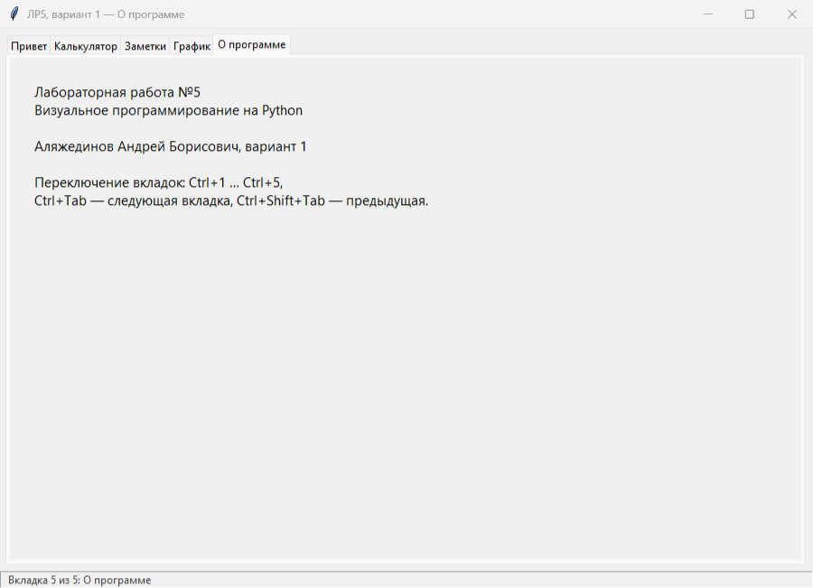
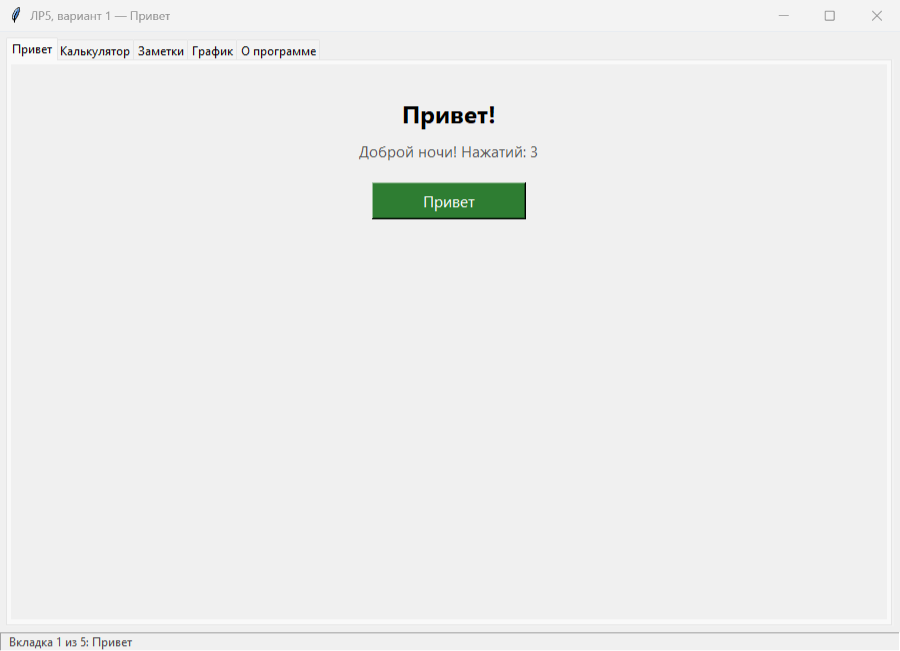
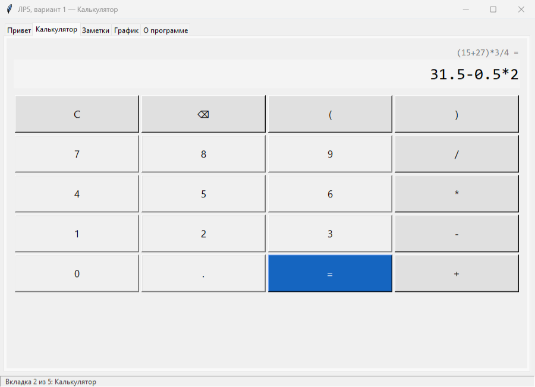
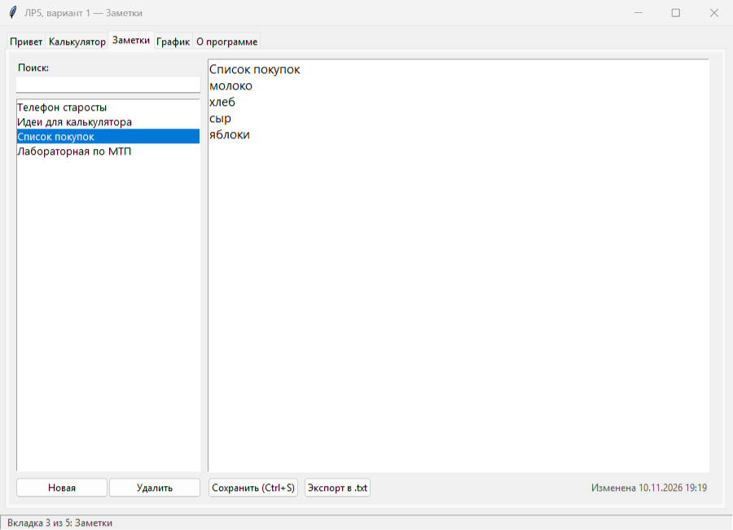
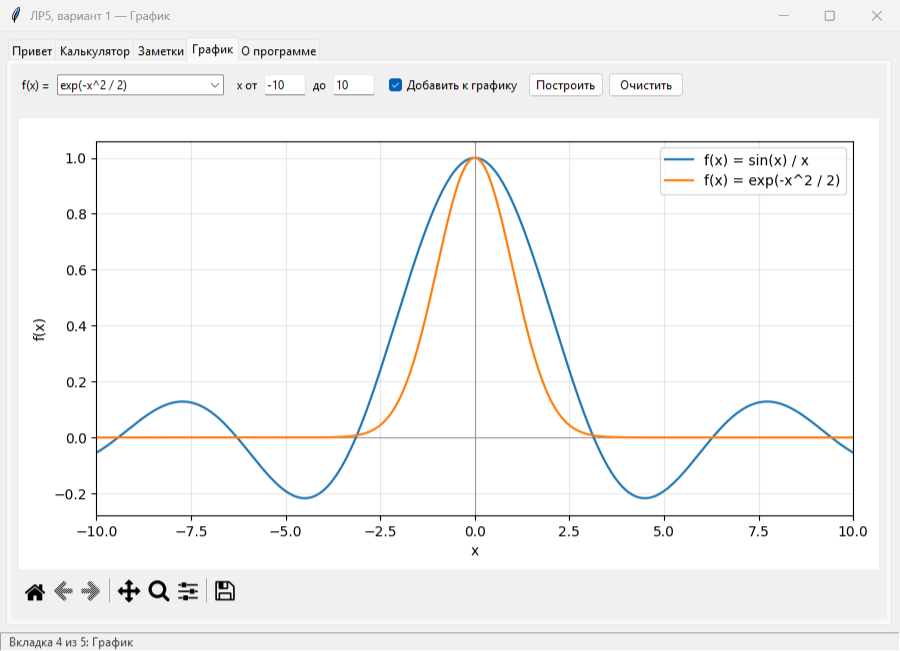

# ЛР5. Визуальное программирование на Python

Аляжединов Андрей Борисович, вариант 1.
Дисциплина «Методы и технологии программирования» (часть 1).

Цель работы — научиться создавать графические интерфейсы на Tkinter.

## Задания варианта 1

| Задание | Что сделано | Файл |
|---|---|---|
| Средн. 1 | Окно с кнопкой «Привет» | `lab5/hello.py` |
| Средн. 3 | Простейший калькулятор | `lab5/calc.py`, `lab5/expr.py` |
| Средн. 5 | Программа со вкладками (`ttk.Notebook`) | `lab5/app.py` |
| Повыш. 1 | Программа «Заметки» с сохранением в файл | `lab5/notes.py`, `lab5/notes_store.py` |
| Повыш. 4 | График matplotlib внутри Tkinter | `lab5/plot.py` |

Все задания собраны в одном окне: каждое задание — отдельная вкладка.
Любое задание можно запустить и отдельно.

## Запуск

Нужен Python 3.10 или новее. Tkinter входит в стандартную поставку
Python для Windows, matplotlib ставится из `requirements.txt`.

```bash
pip install -r requirements.txt
python main.py
```

Отдельные задания:

```bash
python -m lab5.hello
python -m lab5.calc
python -m lab5.notes
python -m lab5.plot
```

Тесты:

```bash
python -m unittest discover -s tests -t .
```

## Структура проекта

```
main.py               запуск главного окна
lab5/app.py           главное окно с вкладками
lab5/hello.py         окно с кнопкой «Привет»
lab5/calc.py          калькулятор
lab5/expr.py          разбор и вычисление выражений
lab5/notes.py         окно «Заметки»
lab5/notes_store.py   хранение заметок в JSON-файле
lab5/plot.py          график функции
tests/                модульные тесты (unittest)
docs/                 снимки окон
```

## Средн. 5. Программа со вкладками

Главное окно построено на `ttk.Notebook`. В нём пять вкладок, по одной
на каждое задание, и вкладка «О программе». В строке состояния видно,
какая вкладка открыта, заголовок окна меняется вместе с ней. Вкладки
переключаются мышью, клавишами Ctrl+1 … Ctrl+5 и Ctrl+Tab.



## Средн. 1. Окно с кнопкой «Привет»

По нажатию на кнопку надпись меняется на «Привет!». Ниже выводится
приветствие по времени суток и число нажатий.



## Средн. 3. Калькулятор

Выражение набирается кнопками или с клавиатуры. Поддерживаются
скобки, приоритет операций и дробные числа. Enter считает результат,
Esc очищает поле. Над полем ввода остаётся последнее выражение, а с
результатом можно продолжать вычисления.

Выражение не передаётся в `eval`. Модуль `expr.py` разбирает его через
`ast` и пропускает только числа, арифметические операции и несколько
математических функций. Ошибки (деление на ноль, лишний знак и т. п.)
выводятся под кнопками, а набранное выражение не стирается.



## Повыш. 1. Заметки

Заметки хранятся в файле `notes.json` рядом с программой. Сохранение
идёт через временный файл, поэтому при сбое файл не портится.
Заголовком заметки становится её первая строка.

Что умеет окно:

- создавать, сохранять и удалять заметки (удаление — после подтверждения);
- искать по тексту, список фильтруется прямо при вводе;
- сохранять по Ctrl+S, в том числе при русской раскладке;
- экспортировать заметку в `.txt` через стандартный диалог;
- предлагать сохранить изменения при переходе к другой заметке и при
  закрытии программы.



## Повыш. 4. График matplotlib в Tkinter

Фигура matplotlib встроена в окно через `FigureCanvasTkAgg`. Под ней
стоит стандартная панель инструментов `NavigationToolbar2Tk`: масштаб,
перемещение и сохранение картинки.

Функция вводится формулой от `x` или выбирается из списка примеров.
Формулу разбирает тот же модуль `expr.py`, что и в калькуляторе.
Отрезок задаётся полями «от» и «до». В точках, где функция не
определена (например, `sin(x) / x` при `x = 0` или `sqrt(x)` при `x < 0`),
график просто прерывается. С флажком «Добавить к графику» новые
функции рисуются поверх старых.



## Тесты

```
> python -m unittest discover -s tests -t .
..................................
----------------------------------------------------------------------
Ran 34 tests in 3.4s

OK
```

Логика заданий (вычисление выражений, хранилище заметок, построение
точек графика) проверяется без окон. Тесты виджетов создают скрытое окно
и нажимают кнопки через `invoke()`.

## Ветки

Задания повышенной сложности сделаны в ветках `feature/notes` и
`feature/plot` и слиты в `main`.
